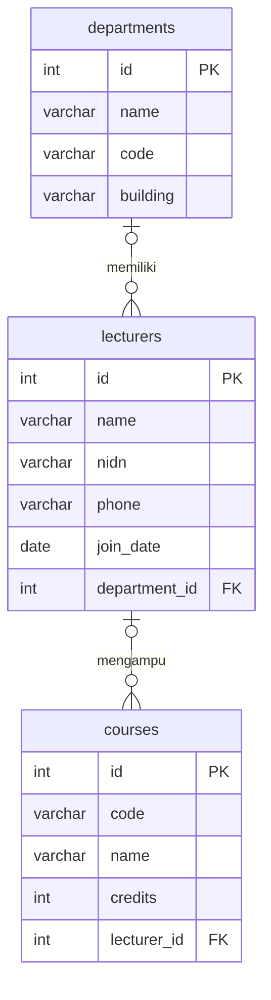
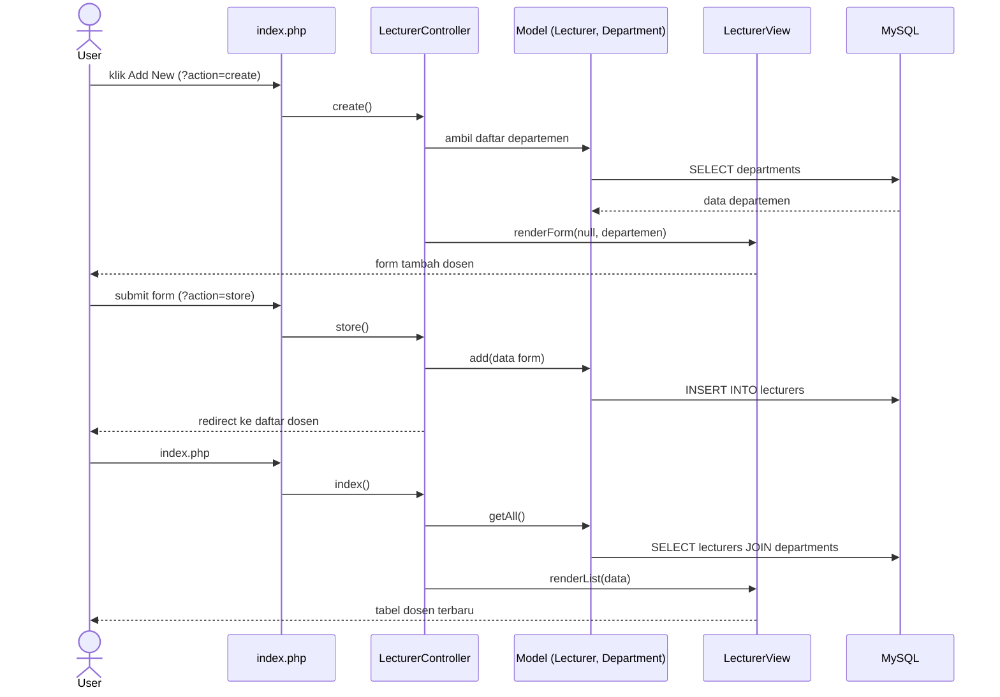
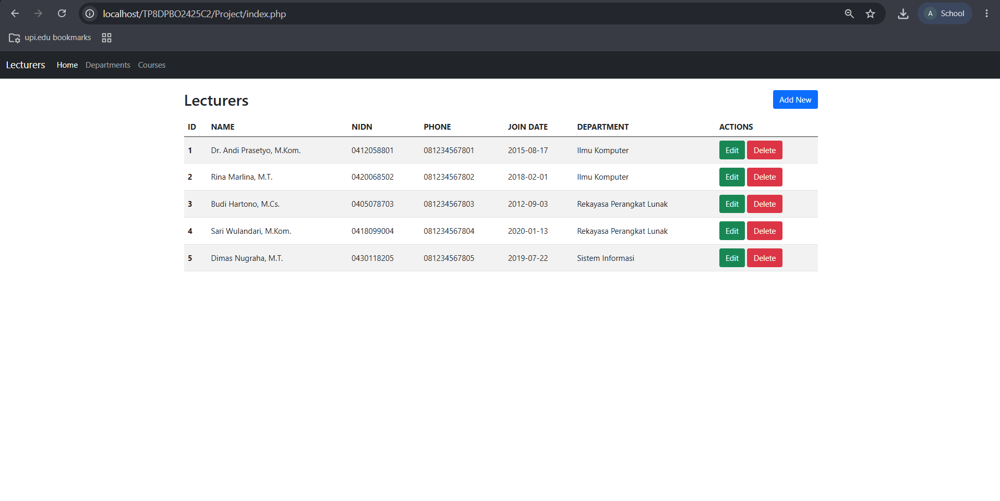
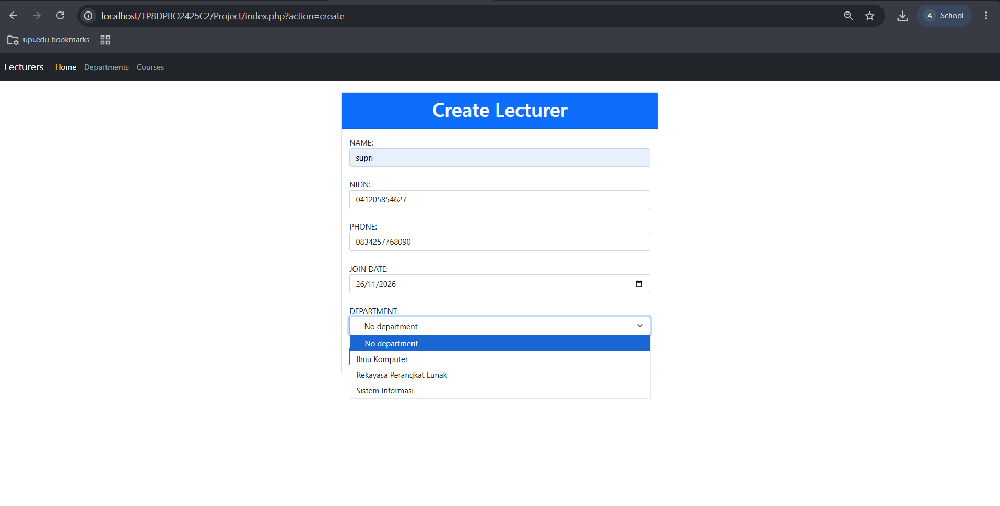
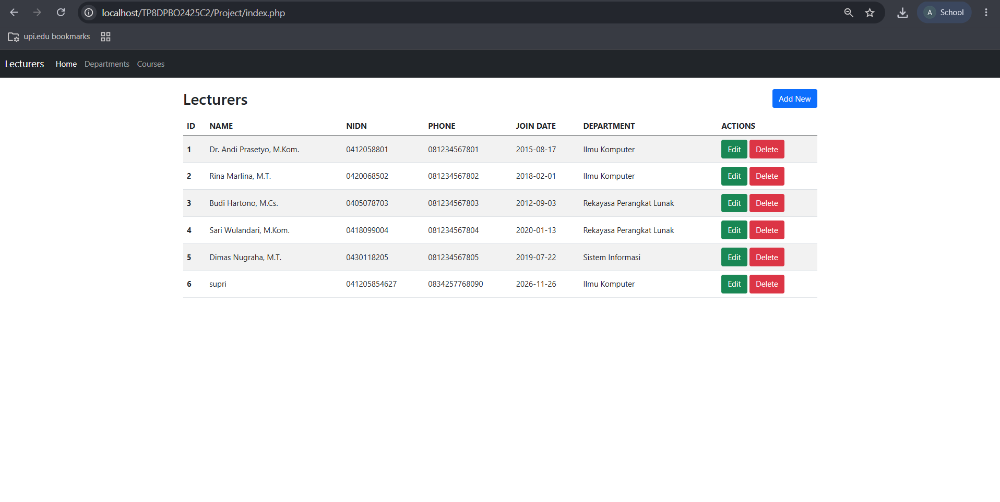
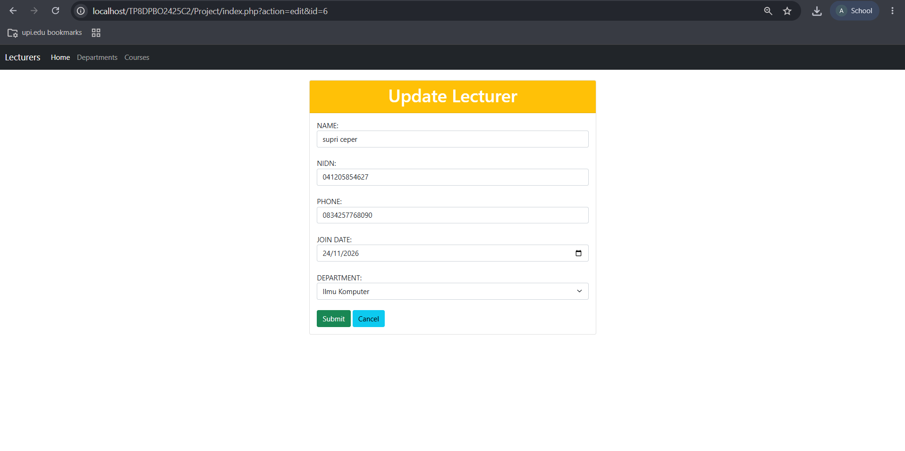
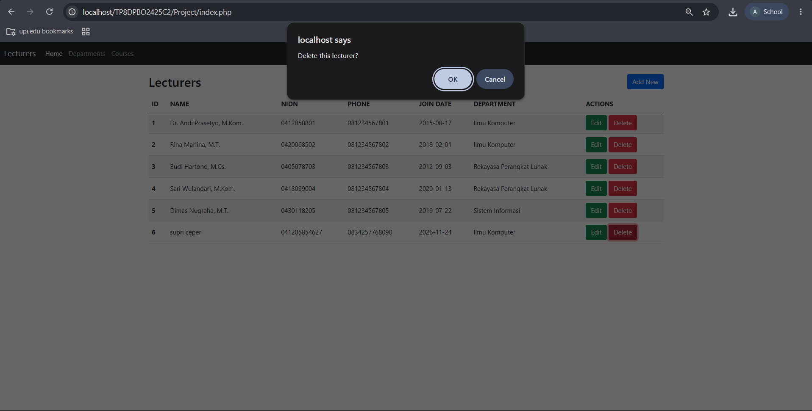

# Janji

Saya Ahmad Jazil Rizki dengan NIM 2501839 mengerjakan Tugas Praktikum 8 dalam mata kuliah Desain dan Pemrograman Berbasis Objek untuk keberkahanNya maka saya tidak melakukan kecurangan seperti yang telah dispesifikasikan. Aamiin.

---

# Lecturer Management (PHP MVC)

Aplikasi web sederhana untuk mengelola data **dosen**, **departemen**, dan **mata kuliah**. Aplikasi ini dibangun dengan PHP native dan MySQL, dengan arsitektur **Model - View - Controller (MVC)** supaya logika data, tampilan, dan alur request terpisah dengan jelas.

Fitur utama:

- CRUD dosen (lecturers), lengkap dengan pilihan departemen
- CRUD departemen (departments), menampilkan jumlah dosen tiap departemen
- CRUD mata kuliah (courses), lengkap dengan pilihan dosen pengampu

## Desain Program

### Desain Database

Database bernama `tp_mvc25` berisi tiga tabel yang saling berelasi.



| Tabel | Keterangan | Relasi |
|---|---|---|
| `lecturers` | Data dosen (nama, NIDN, telepon, tanggal bergabung) | Banyak dosen berada di 1 departemen (`department_id`) |
| `departments` | Data departemen (nama, kode, gedung) | 1 departemen memiliki banyak dosen |
| `courses` | Data mata kuliah (kode, nama, SKS) | Banyak mata kuliah diampu 1 dosen (`lecturer_id`) |

Kedua foreign key memakai `ON DELETE SET NULL`. Artinya, jika sebuah departemen dihapus, dosen di dalamnya tetap ada dengan departemen kosong. Begitu juga jika dosen dihapus, mata kuliahnya tetap ada dengan dosen kosong.

### Struktur Folder

```
TP8DPBO2425C2/
├── Project/
│   ├── assets/                      # Bootstrap (css & js)
│   ├── controllers/
│   │   ├── LecturerController.php
│   │   ├── DepartmentController.php
│   │   └── CourseController.php
│   ├── models/
│   │   ├── DB.php                   # koneksi & eksekusi query
│   │   ├── Lecturer.php
│   │   ├── Department.php
│   │   └── Course.php
│   ├── templates/                   # file html dengan placeholder DATA_XXX
│   │   ├── layout.html              # kerangka halaman + navbar
│   │   ├── lecturer_list.html / lecturer_form.html
│   │   ├── department_list.html / department_form.html
│   │   └── course_list.html / course_form.html
│   ├── views/
│   │   ├── Template.php             # pengisi placeholder
│   │   ├── BaseView.php             # pembungkus layout
│   │   ├── LecturerView.php
│   │   ├── DepartmentView.php
│   │   └── CourseView.php
│   ├── config.php                   # pengaturan koneksi database
│   ├── index.php                    # halaman dosen (Home)
│   ├── departments.php              # halaman departemen
│   └── courses.php                  # halaman mata kuliah
├── Dokumentasi/
│   ├── Lecturers/                   # screenshot CRUD dosen
│   ├── demodepartemen.mp4           # screen record CRUD departemen
│   └── democourses.mp4              # screen record CRUD mata kuliah
├── tp_mvc25.sql                     # struktur & data awal database
└── ReadMe.md
```

### Pembagian Peran MVC

| Komponen | Tugas | File |
|---|---|---|
| **Model** | Satu-satunya bagian yang berbicara dengan database. Berisi query (select, insert, update, delete) memakai prepared statement. | `models/*.php` |
| **View** | Menyusun tampilan HTML dari data yang diterima. Semua teks dari database di-escape dengan `e()` sebelum ditampilkan. | `views/*.php` dan `templates/*.html` |
| **Controller** | Menerima request dari user, meminta data ke model, lalu meneruskannya ke view. Setelah simpan/ubah/hapus, controller mengarahkan kembali ke halaman daftar. | `controllers/*.php` |

File `index.php`, `departments.php`, dan `courses.php` berperan sebagai pintu masuk. Masing-masing membaca parameter `?action=` lalu memanggil method controller yang sesuai.

| `?action=` | Method controller | Fungsi |
|---|---|---|
| *(kosong)* | `index()` | Menampilkan daftar data |
| `create` | `create()` | Menampilkan form tambah |
| `store` | `store()` | Menyimpan data baru (POST) |
| `edit&id=..` | `edit()` | Menampilkan form ubah |
| `update` | `update()` | Menyimpan perubahan (POST) |
| `delete` | `delete()` | Menghapus data (POST) |

## Alur Program

### Alur Umum

1. User membuka sebuah halaman, misalnya `index.php`.
2. File tersebut membuat controller dan memanggil method sesuai `?action=`.
3. Controller meminta data ke model.
4. Model menjalankan query ke database dan mengembalikan hasilnya.
5. Controller mengirim data ke view.
6. View mengisi template HTML dan menampilkannya ke user.

### Contoh Alur: Menambah Dosen



### Alur Ubah dan Hapus

- **Ubah**: tombol Edit membuka `?action=edit&id=..`. Controller mengambil 1 data berdasarkan id, lalu view menampilkan form yang sudah terisi. Saat disubmit, `update()` menyimpan perubahan lalu kembali ke daftar.
- **Hapus**: tombol Delete mengirim id lewat form POST setelah dikonfirmasi. `delete()` menghapus data lalu kembali ke daftar.

### Catatan Keamanan

- Semua query yang membawa input user memakai prepared statement, sehingga aman dari SQL injection.
- Semua data yang ditampilkan di-escape dengan `htmlspecialchars` (fungsi `e()`), sehingga aman dari XSS.
- Penghapusan memakai method POST, bukan link biasa.

## Cara Menjalankan

1. Nyalakan **Apache** dan **MySQL** di XAMPP (PHP 7.4 ke atas).
2. Buka `localhost/phpmyadmin`, pilih tab **Import**, lalu import file `tp_mvc25.sql`. File ini membuat database `tp_mvc25` beserta tabel dan data awalnya.
3. Salin seluruh folder `TP8DPBO2425C2` ke `C:\xampp\htdocs\`.
4. Jika user/password MySQL berbeda dari bawaan XAMPP, sesuaikan di `Project/config.php`.
5. Buka di browser:
   - `localhost/TP8DPBO2425C2/Project/` untuk halaman Lecturers
   - `localhost/TP8DPBO2425C2/Project/departments.php` untuk halaman Departments
   - `localhost/TP8DPBO2425C2/Project/courses.php` untuk halaman Courses

## Dokumentasi

Dokumentasi disimpan di folder `Dokumentasi/`. CRUD dosen didokumentasikan dengan screenshot, sedangkan CRUD departemen dan mata kuliah didokumentasikan dengan screen record.

### Lecturers

**1. Tampilan awal**

Daftar dosen beserta nama departemennya, hasil join tabel `lecturers` dan `departments`.



**2. Menambah dosen**

Form Create Lecturer. Dropdown Department berisi data dari tabel `departments`.



**3. Setelah dosen ditambahkan**

Dosen baru langsung muncul di daftar dengan departemen yang dipilih.



**4. Mengubah dosen**

Form Update Lecturer yang sudah terisi data dosen terpilih, termasuk departemennya.



**5. Konfirmasi hapus**

Sebelum data dihapus, muncul konfirmasi. Pada daftar di belakangnya juga terlihat hasil perubahan dari langkah sebelumnya.



**6. Setelah dosen dihapus**

Data dosen yang dihapus sudah tidak ada di daftar.


### Departments

Screen record CRUD departemen (tambah, ubah, hapus): [demodepartemen.mp4](Dokumentasi/demodepartemen.mp4)

### Courses

Screen record CRUD mata kuliah (tambah, ubah, hapus): [democourses.mp4](Dokumentasi/democourses.mp4)
